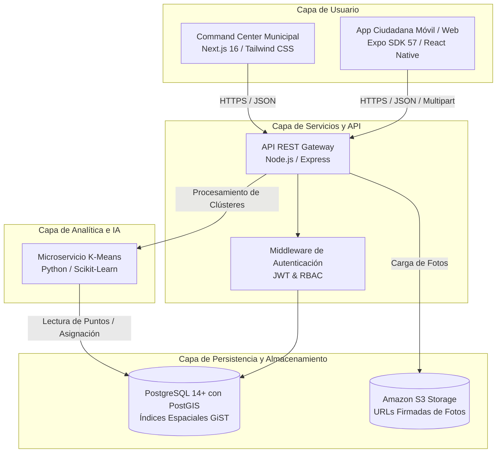

# Recolecta+

[](https://github.com/Jamesllm/Recolecta)
[](https://nodejs.org/)
[](https://www.postgresql.org/)
[](https://postgis.net/)
[](https://expo.dev/)
[](https://reactnative.dev/)
[](https://nextjs.org/)
[](https://www.python.org/)
[](https://scikit-learn.org/)
[](https://aws.amazon.com/s3/)
[](https://www.typescriptlang.org/)

Plataforma integral, distribuida y georreferenciada para la fiscalizacion comunitaria, monitoreo en tiempo real y optimizacion inteligente de rutas de recoleccion de residuos solidos urbanos.

---

## Indice de Contenidos

- [Contexto del Proyecto](#contexto-del-proyecto)
- [Arquitectura del Sistema](#arquitectura-del-sistema)
- [Modulos y Componentes](#modulos-y-componentes)
- [Entregables del Sprint 1](#entregables-del-sprint-1)
- [Requisitos de Infraestructura](#requisitos-de-infraestructura)
- [Guia de Instalacion y Despliegue](#guia-de-instalacion-y-despliegue)
- [Especificacion de la API REST](#especificacion-de-la-api-rest)
- [Motor de Inteligencia Artificial](#motor-de-inteligencia-artificial)
- [Estandares de Seguridad y Calidad](#estandares-de-seguridad-y-calidad)

---

## Contexto del Proyecto

Proyecto desarrollado en el marco de la asignatura **Innovacion y Transformacion Digital** (Periodo Academico 2026-2) en la Universidad Tecnologica del Peru (UTP).

### Equipo de Ingenieria (Grupo 3)

| Rol | Nombre y Apellidos |
|:---|:---|
| Product Owner | Ronal James Llapapasca Montes |
| Scrum Master | Carlos Andres Bustamante Suclupe |
| Lead Developer | Danna Jael Minan Gonzalez |
| Core Developer | Victor Miguel Alonso Reyes Flores |
| QA & Cloud Specialist | Angel Eduardo Salas Bances |

---

## Arquitectura del Sistema

El ecosistema opera bajo un patron de arquitectura desacoplada y orientada a servicios, dividida en cuatro capas especializadas:



---

## Modulos y Componentes

| Modulo | Directorio | Pila Tecnologica | Proposito |
|:---|:---|:---|:---|
| **App Ciudadana** | [`mobile/`](mobile/) | React Native, Expo SDK 57, Expo Router, Leaflet, OpenStreetMap | Registro vecinal, geolocalizacion asistida, captura de evidencia fotografica, consulta de reportes en radio de 500 m. |
| **API Backend** | [`backend/`](backend/) | Node.js 20+, Express, PostgreSQL, PostGIS, JWT, AWS SDK | Logica de negocio central, endpoints transaccionales, consultas espaciales en WGS84 (`SRID 4326`), validacion de ubigeo nacional. |
| **Motor de IA** | [`backend/ai/`](backend/ai/) | Python 3.11+, Scikit-Learn, Pandas, NumPy, Psycopg2 | Clustering espacial K-Means no supervisado de focos criticos y secuenciamiento de paradas de recoleccion. |
| **Centro de Mando** | [`frontend/`](frontend/) | Next.js 16 (App Router), TypeScript, Tailwind CSS, React-Leaflet | Monitoreo operacional de cuadrillas, mapas de calor, tracking de camiones recolectores y administracion de incidentes. |

---

## Entregables del Sprint 1

Periodo de ejecucion: **10 al 17 de octubre de 2026**.

| Historia de Usuario | Descripcion Funcional | Capa de Implementacion |
|:---|:---|:---|
| `US-02` **Reporte de Residuos con Foto y GPS** | Reporte con cuenta o como invitado: captura o seleccion de foto, compresion automatica, geolocalizacion GPS con ajuste manual en mapa y referencia opcional, tipo y tamano del residuo, persistencia en Amazon S3 y PostGIS y codigo de seguimiento. | `mobile/`, `POST /api/reports` |
| `US-03` **Mapa de Puntos Cercanos** | Reportes en un radio de 500 m con marcadores por estado (pendiente, en ruta, resuelto o critico), filtros por estado y hoja de detalle con urgencia, tiempo desde el reporte, confirmaciones de vecinos y acciones «Sigue ahi» y «Reportar otro». | `mobile/`, `GET /api/reports/nearby`, `POST /api/reports/:id/confirm` |
| `US-04` **Panel General y Clusteres** | Indicadores del dia (incidentes abiertos, criticos sin asignar, rutas activas y toneladas recolectadas estimadas), mapa de calor, incidentes recientes, zonas prioritarias con carga estimada y «Optimizar rutas con IA» (K-Means). | `frontend/`, `GET /api/incidents/summary`, `GET /api/clusters`, `POST /api/clusters/run` |

El registro e inicio de sesion del ciudadano (`US-01`) paso al Sprint 2 en la replanificacion del 13 de octubre de 2026; la app ya lo incluye, pero no es requisito para reportar.

### Sprint 2 (en curso)

Criterios de aceptacion y estado de cada uno: [docs/sprint-2/criterios-aceptacion.md](docs/sprint-2/criterios-aceptacion.md).

| Historia de Usuario | Descripcion Funcional | Capa de Implementacion |
|:---|:---|:---|
| `US-01` **Registro e Inicio de Sesion** | Crear cuenta con ubigeo, iniciar sesion y recuperar la contrasena con un enlace por correo que caduca en 30 minutos. | `mobile/`, `POST /api/password/forgot`, `GET /reset-password` |
| `US-05` **Filtros y Revision de Incidentes** | Busqueda y filtros por categoria, urgencia, estado y periodo; detalle con clúster sugerido y linea de seguimiento; seleccion multiple para cambiar estado o asignar a ruta; «Rechazar» con motivo. | `frontend/`, `PATCH /api/incidents/status` |
| `US-01` **Correo de Bienvenida** | Correo «¡Bienvenido a Recolecta+!» al crear la cuenta (se activa en Configuracion). | `backend/`, `POST /api/register` |
| `US-06` **Avisos sobre mis Reportes** | Aviso en la app (campana y bandeja «Notificaciones») cada vez que cambia el estado de un reporte enviado con cuenta, y correo cuando pasa a «Resuelto». | `mobile/`, `GET /api/notifications` |

Prototipo de diseno UI/UX validado: [Prototipo en Figma](https://www.figma.com/proto/ay8UeV1wq2jKnHS90bKZz3/Recolecta-?node-id=25-5&t=aOT8hrXgXpSaUAUk-1).

---

## Requisitos de Infraestructura

- **Node.js**: Version 18.0.0 o superior (recomendado 20.x LTS).
- **Python**: Version 3.11 o superior.
- **PostgreSQL**: Version 14 o superior con extension espacial **PostGIS** habilitada.
- **Amazon S3**: Bucket configurado con credenciales de acceso o emulacion compatible S3.
- **Entorno de ejecucion movil**: Expo Go instalado en dispositivo movil fisico (Android o iOS) o emulador de navegador web.

---

## Guia de Instalacion y Despliegue

### 1. Configuracion del Backend y Base de Datos

```bash
# Acceder al directorio backend
cd backend

# Duplicar y configurar variables de entorno
cp .env.example .env

# Instalar dependencias del servidor
npm install

# Inicializar esquema de base de datos, extension PostGIS y ubigeo oficial
npm run db:init

# Iniciar servidor en modo desarrollo
npm run dev
```

El servidor quedara activo en `http://localhost:4000/api`.

### 2. Configuracion de la Aplicacion Movil (Ciudadano)

```bash
# Acceder al directorio mobile
cd mobile

# Configurar direccion IP del servidor
cp .env.example .env

# Instalar paquetes dependientes
npm install

# Iniciar Metro Bundler
npx expo start
```

- Para ejecucion en dispositivo movil: escanear el codigo QR mediante la aplicacion **Expo Go** (ambos dispositivos en la misma red Wi-Fi).
- Para ejecucion web en navegador: presionar la tecla `w` en la consola interactiva de Expo (`http://localhost:8081`).

### 3. Configuracion del Centro de Mando Web (Municipalidad)

```bash
# Acceder al directorio frontend
cd frontend

# Configurar variables locales
cp .env.example .env.local

# Instalar dependencias
npm install

# Iniciar servidor Next.js
npm run dev
```

La consola administrativa estara disponible en `http://localhost:3000`.

### 4. Configuracion del Servicio de Clustering IA

```bash
# Acceder al entorno del modulo de IA
cd backend/ai

# Crear y activar entorno virtual
python -m venv venv
# En Windows:
venv\Scripts\activate
# En Linux/macOS:
source venv/bin/activate

# Instalar dependencias de computo cientifico
pip install -r requirements.txt

# Ejecucion manual del pipeline de agrupamiento
python cluster_service.py -k 3
```

---

## Especificacion de la API REST

### Autenticacion y Territorio

| Metodo | Endpoint | Descripcion | Autenticacion |
|:---|:---|:---|:---:|
| `POST` | `/api/register` | Registro de nuevo ciudadano con ubigeo | No |
| `POST` | `/api/login` | Autenticacion de usuario y emision de token JWT | No |
| `GET` | `/api/me` | Informacion del usuario autenticado | Requerida |
| `POST` | `/api/password/forgot` | Envia por correo el enlace para crear una nueva contrasena (caduca en 30 min) | No |
| `POST` | `/api/password/reset` | Guarda la nueva contrasena con el token del enlace | No |
| `GET` | `/reset-password?token=` | Pagina web que abre el enlace del correo | No |
| `GET` | `/api/ubigeo/departamentos` | Catalogo nacional de departamentos | No |
| `GET` | `/api/ubigeo/departamentos/:id/provincias` | Provincias segun departamento | No |
| `GET` | `/api/ubigeo/provincias/:id/distritos` | Distritos segun provincia | No |

### Reportes e Incidentes

| Metodo | Endpoint | Descripcion | Autenticacion |
|:---|:---|:---|:---:|
| `POST` | `/api/reports` | Creacion de reporte georreferenciado con imagen multipart | Cuenta o invitado |
| `GET` | `/api/reports/nearby` | Consulta geoespacial de incidentes en radio metrico (ST_DWithin) | Cuenta o invitado |
| `GET` | `/api/reports/mine` | Reportes de la cuenta y de los enviados como invitado desde el telefono | Cuenta o invitado |
| `GET` | `/api/reports/:id` | Detalle estructurado de un incidente individual | Cuenta o invitado |
| `POST` | `/api/reports/:id/confirm` | Confirmacion «Sigue ahi» de otro vecino | Cuenta o invitado |
| `GET` | `/api/incidents` | Listado consolidado para el panel municipal con filtros | No (inicio de sesion del panel: US-10) |
| `GET` | `/api/incidents/summary` | Indicadores del dia del panel general | No (inicio de sesion del panel: US-10) |
| `PATCH` | `/api/incidents/:id/status` | Transicion de estado (`pending`, `assigned`, `resolved` o `rejected` con `reason`); registra el historial y avisa al vecino | No (inicio de sesion del panel: US-10) |
| `PATCH` | `/api/incidents/status` | Cambio de estado de varios incidentes seleccionados (`{ ids, status }`) | No (inicio de sesion del panel: US-10) |

### Panel: Rutas, Analisis, Flota y Configuracion

Trabajo adelantado del Sprint 3 (detalle en [docs/sprint-2/criterios-aceptacion.md](docs/sprint-2/criterios-aceptacion.md)). La ruta por calles usa OSRM sobre OpenStreetMap; `OSRM_URL` en `backend/.env` permite usar un servidor propio.

| Metodo | Endpoint | Descripcion | Autenticacion |
|:---|:---|:---|:---:|
| `GET` | `/api/clusters/:id/route` | Ruta por calles (OSRM) de las paradas pendientes o en ruta del cluster | No (inicio de sesion del panel: US-10) |
| `GET` | `/api/analytics?days=7\|30\|90` | Indicadores del servicio, serie, categorias, estados y ranking de zonas (US-09) | No (inicio de sesion del panel: US-10) |
| `GET` `POST` | `/api/fleet` | Camiones de la flota y registro de uno nuevo | No (inicio de sesion del panel: US-10) |
| `PATCH` `DELETE` | `/api/fleet/:id` | Editar estado, conductor o capacidad; eliminar | No (inicio de sesion del panel: US-10) |
| `POST` | `/api/fleet/:id/assign` `/api/fleet/:id/release` | Asignar el camion a la ruta de un cluster (pasa sus reportes a «En ruta») o liberarlo | No (inicio de sesion del panel: US-10) |
| `GET` `PATCH` | `/api/settings` | Parametros de K-Means y reglas de correo | No (inicio de sesion del panel: US-10) |
| `GET` | `/api/users/summary` | Equipo municipal y resumen de vecinos registrados (sin correos) | No (inicio de sesion del panel: US-10) |

### Avisos del Vecino

| Metodo | Endpoint | Descripcion | Autenticacion |
|:---|:---|:---|:---:|
| `GET` | `/api/notifications` | Avisos del vecino y cantidad sin leer | Requerida |
| `GET` | `/api/notifications/unread-count` | Cantidad sin leer (campana del mapa) | Requerida |
| `POST` | `/api/notifications/:id/read` | Marca un aviso como leido | Requerida |
| `POST` | `/api/notifications/read-all` | Marca todos los avisos como leidos | Requerida |

### Analitica y Rutas

| Metodo | Endpoint | Descripcion | Autenticacion |
|:---|:---|:---|:---:|
| `GET` | `/api/clusters` | Obtencion de agrupaciones espaciales calculadas | No (inicio de sesion del panel: US-10) |
| `POST` | `/api/clusters/run` | Disparo bajo demanda del clustering K-Means | No (inicio de sesion del panel: US-10) |

---

## Motor de Inteligencia Artificial

El servicio ubicado en `backend/ai/cluster_service.py` aplica el algoritmo de aprendizaje no supervisado **K-Means** sobre los reportes en estado `pending`. El modelo vive en `backend/ai/clustering.py`, que comparten el servicio y el notebook de evaluación.

1. **Extraccion**: Consulta a PostgreSQL de los reportes pendientes con su ubicacion y tamaño estimado.
2. **Preparacion**: Conversion de latitud y longitud a metros (proyeccion equirectangular local) y peso de cada reporte = toneladas estimadas segun su tamaño.
3. **Eleccion de K (Sprint 2)**: Si el gestor deja «Automatico (IA)», se entrena un modelo por cada K de 2 a 8 y se usa el de mayor coeficiente de silueta. Tambien puede indicar K a mano.
4. **Persistencia Transaccional**: Registro de la ejecucion (K, modo, silueta y Davies-Bouldin) en `cluster_runs`, de los clústeres en `clusters` y asociacion de cada incidente a su clúster.
5. **Ruta Heuristica**: El panel ordena las paradas de cada clúster por vecino mas cercano a partir del centroide.

### Evaluacion del modelo (APF3)

- `backend/ai/notebooks/evaluacion_kmeans.ipynb`: eleccion de K (codo, silueta y Davies-Bouldin), validacion contra focos conocidos (ARI y tabla foco × clúster), prueba 80/20, comparacion con otras opciones (grados, sin pesos, DBSCAN) y estabilidad con 20 datasets. Las figuras se guardan en `backend/ai/notebooks/figuras/`.
- `backend/ai/simulate_reports.py`: genera `backend/ai/data/reportes_simulados_chiclayo.csv`, 400 reportes **simulados** alrededor de cinco focos inventados en el centro de Chiclayo. Con `--load` los carga en la BD como pendientes (marcados con `device_id = 'simulado-apf3'`) y con `--clear` los borra.

```bash
cd backend/ai
pip install -r requirements-notebook.txt
python simulate_reports.py --load      # datos de prueba en la BD
python cluster_service.py              # K automatico por silueta
python cluster_service.py -k 4         # K fijo
```

---

## Estandares de Seguridad y Calidad

- **Seguridad en Reposo y Transito**: Cifrado de contrasenas mediante `bcrypt` con factor de coste 10, autenticacion stateless con tokens `JWT` firmados con clave HMAC-SHA256 de alta entropia.
- **Rendimiento Geoespacial**: Consultas de proximidad optimizadas con funciones nativas de PostGIS (`ST_DWithin`, `ST_DistanceSphere`) soportadas por indices espaciales de arbol `GiST` sobre la columna `location`.
- **Politicas de CORS Robustas**: Control de acceso a recursos de origen cruzado parametrizado dinamicamente para consumo seguro desde clientes moviles nativos y dominios web autorizados.
- **Almacenamiento Concurrente**: Almacenamiento seguro de objetos multimedia en Amazon S3 mediante el uso de URLs pre-firmadas temporales, evitando la sobrecarga del servidor de aplicaciones.
