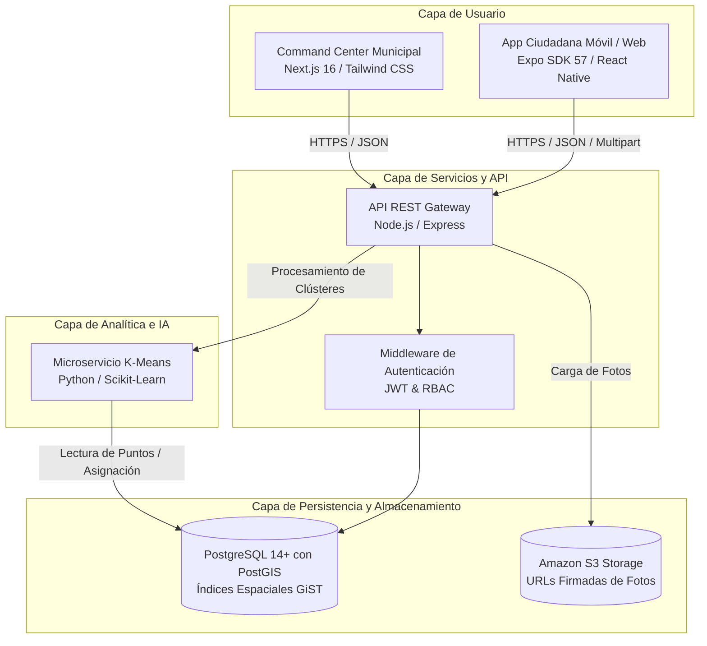

# Recolecta+

[](https://github.com/Jamesllm/Recolecta)
[](https://nodejs.org/)
[](https://www.postgresql.org/)
[](https://postgis.net/)
[](https://expo.dev/)
[](https://reactnative.dev/)
[](https://nextjs.org/)
[](https://www.python.org/)
[](https://scikit-learn.org/)
[](https://aws.amazon.com/s3/)
[](https://www.typescriptlang.org/)

Plataforma integral, distribuida y georreferenciada para la fiscalizacion comunitaria, monitoreo en tiempo real y optimizacion inteligente de rutas de recoleccion de residuos solidos urbanos.

---

## Indice de Contenidos

- [Contexto del Proyecto](#contexto-del-proyecto)
- [Arquitectura del Sistema](#arquitectura-del-sistema)
- [Modulos y Componentes](#modulos-y-componentes)
- [Entregables del Sprint 1](#entregables-del-sprint-1)
- [Requisitos de Infraestructura](#requisitos-de-infraestructura)
- [Guia de Instalacion y Despliegue](#guia-de-instalacion-y-despliegue)
- [Especificacion de la API REST](#especificacion-de-la-api-rest)
- [Motor de Inteligencia Artificial](#motor-de-inteligencia-artificial)
- [Estandares de Seguridad y Calidad](#estandares-de-seguridad-y-calidad)

---

## Contexto del Proyecto

Proyecto desarrollado en el marco de la asignatura **Innovacion y Transformacion Digital** (Periodo Academico 2026-2) en la Universidad Tecnologica del Peru (UTP).

### Equipo de Ingenieria (Grupo 3)

| Rol | Nombre y Apellidos |
|:---|:---|
| Product Owner | Ronal James Llapapasca Montes |
| Scrum Master | Carlos Andres Bustamante Suclupe |
| Lead Developer | Danna Jael Minan Gonzalez |
| Core Developer | Victor Miguel Alonso Reyes Flores |
| QA & Cloud Specialist | Angel Eduardo Salas Bances |

---

## Arquitectura del Sistema

El ecosistema opera bajo un patron de arquitectura desacoplada y orientada a servicios, dividida en cuatro capas especializadas:



---

## Modulos y Componentes

| Modulo | Directorio | Pila Tecnologica | Proposito |
|:---|:---|:---|:---|
| **App Ciudadana** | [`mobile/`](mobile/) | React Native, Expo SDK 57, Expo Router, Leaflet, OpenStreetMap | Registro vecinal, geolocalizacion asistida, captura de evidencia fotografica, consulta de reportes en radio de 500 m. |
| **API Backend** | [`backend/`](backend/) | Node.js 20+, Express, PostgreSQL, PostGIS, JWT, AWS SDK | Logica de negocio central, endpoints transaccionales, consultas espaciales en WGS84 (`SRID 4326`), validacion de ubigeo nacional. |
| **Motor de IA** | [`backend/ai/`](backend/ai/) | Python 3.11+, Scikit-Learn, Pandas, NumPy, Psycopg2 | Clustering espacial K-Means no supervisado de focos criticos y secuenciamiento de paradas de recoleccion. |
| **Centro de Mando** | [`frontend/`](frontend/) | Next.js 16 (App Router), TypeScript, Tailwind CSS, React-Leaflet | Monitoreo operacional de cuadrillas, mapas de calor, tracking de camiones recolectores y administracion de incidentes. |

---

## Entregables del Sprint 1

Periodo de ejecucion: **10 al 17 de octubre de 2026**.

| Historia de Usuario | Descripcion Funcional | Capa de Implementacion |
|:---|:---|:---|
| `US-02` **Reporte de Residuos con Foto y GPS** | Reporte con cuenta o como invitado: captura o seleccion de foto, compresion automatica, geolocalizacion GPS con ajuste manual en mapa y referencia opcional, tipo y tamano del residuo, persistencia en Amazon S3 y PostGIS y codigo de seguimiento. | `mobile/`, `POST /api/reports` |
| `US-03` **Mapa de Puntos Cercanos** | Reportes en un radio de 500 m con marcadores por estado (pendiente, en ruta, resuelto o critico), filtros por estado y hoja de detalle con urgencia, tiempo desde el reporte, confirmaciones de vecinos y acciones «Sigue ahi» y «Reportar otro». | `mobile/`, `GET /api/reports/nearby`, `POST /api/reports/:id/confirm` |
| `US-04` **Panel General y Clusteres** | Indicadores del dia (incidentes abiertos, criticos sin asignar, rutas activas y toneladas recolectadas estimadas), mapa de calor, incidentes recientes, zonas prioritarias con carga estimada y «Optimizar rutas con IA» (K-Means). | `frontend/`, `GET /api/incidents/summary`, `GET /api/clusters`, `POST /api/clusters/run` |

El registro e inicio de sesion del ciudadano (`US-01`) paso al Sprint 2 en la replanificacion del 13 de octubre de 2026; la app ya lo incluye, pero no es requisito para reportar.

Prototipo de diseno UI/UX validado: [Prototipo en Figma](https://www.figma.com/proto/ay8UeV1wq2jKnHS90bKZz3/Recolecta-?node-id=25-5&t=aOT8hrXgXpSaUAUk-1).

---

## Requisitos de Infraestructura

- **Node.js**: Version 18.0.0 o superior (recomendado 20.x LTS).
- **Python**: Version 3.11 o superior.
- **PostgreSQL**: Version 14 o superior con extension espacial **PostGIS** habilitada.
- **Amazon S3**: Bucket configurado con credenciales de acceso o emulacion compatible S3.
- **Entorno de ejecucion movil**: Expo Go instalado en dispositivo movil fisico (Android o iOS) o emulador de navegador web.

---

## Guia de Instalacion y Despliegue

### 1. Configuracion del Backend y Base de Datos

```bash
# Acceder al directorio backend
cd backend

# Duplicar y configurar variables de entorno
cp .env.example .env

# Instalar dependencias del servidor
npm install

# Inicializar esquema de base de datos, extension PostGIS y ubigeo oficial
npm run db:init

# Iniciar servidor en modo desarrollo
npm run dev
```

El servidor quedara activo en `http://localhost:4000/api`.

### 2. Configuracion de la Aplicacion Movil (Ciudadano)

```bash
# Acceder al directorio mobile
cd mobile

# Configurar direccion IP del servidor
cp .env.example .env

# Instalar paquetes dependientes
npm install

# Iniciar Metro Bundler
npx expo start
```

- Para ejecucion en dispositivo movil: escanear el codigo QR mediante la aplicacion **Expo Go** (ambos dispositivos en la misma red Wi-Fi).
- Para ejecucion web en navegador: presionar la tecla `w` en la consola interactiva de Expo (`http://localhost:8081`).

### 3. Configuracion del Centro de Mando Web (Municipalidad)

```bash
# Acceder al directorio frontend
cd frontend

# Configurar variables locales
cp .env.example .env.local

# Instalar dependencias
npm install

# Iniciar servidor Next.js
npm run dev
```

La consola administrativa estara disponible en `http://localhost:3000`.

### 4. Configuracion del Servicio de Clustering IA

```bash
# Acceder al entorno del modulo de IA
cd backend/ai

# Crear y activar entorno virtual
python -m venv venv
# En Windows:
venv\Scripts\activate
# En Linux/macOS:
source venv/bin/activate

# Instalar dependencias de computo cientifico
pip install -r requirements.txt

# Ejecucion manual del pipeline de agrupamiento
python cluster_service.py -k 3
```

---

## Especificacion de la API REST

### Autenticacion y Territorio

| Metodo | Endpoint | Descripcion | Autenticacion |
|:---|:---|:---|:---:|
| `POST` | `/api/register` | Registro de nuevo ciudadano con ubigeo | No |
| `POST` | `/api/login` | Autenticacion de usuario y emision de token JWT | No |
| `GET` | `/api/me` | Informacion del usuario autenticado | Requerida |
| `GET` | `/api/ubigeo/departamentos` | Catalogo nacional de departamentos | No |
| `GET` | `/api/ubigeo/departamentos/:id/provincias` | Provincias segun departamento | No |
| `GET` | `/api/ubigeo/provincias/:id/distritos` | Distritos segun provincia | No |

### Reportes e Incidentes

| Metodo | Endpoint | Descripcion | Autenticacion |
|:---|:---|:---|:---:|
| `POST` | `/api/reports` | Creacion de reporte georreferenciado con imagen multipart | Cuenta o invitado |
| `GET` | `/api/reports/nearby` | Consulta geoespacial de incidentes en radio metrico (ST_DWithin) | Cuenta o invitado |
| `GET` | `/api/reports/mine` | Reportes de la cuenta y de los enviados como invitado desde el telefono | Cuenta o invitado |
| `GET` | `/api/reports/:id` | Detalle estructurado de un incidente individual | Cuenta o invitado |
| `POST` | `/api/reports/:id/confirm` | Confirmacion «Sigue ahi» de otro vecino | Cuenta o invitado |
| `GET` | `/api/incidents` | Listado consolidado para el panel municipal con filtros | No (inicio de sesion del panel: US-10) |
| `GET` | `/api/incidents/summary` | Indicadores del dia del panel general | No (inicio de sesion del panel: US-10) |
| `PATCH` | `/api/incidents/:id/status` | Transicion de estado de atencion de incidente | No (inicio de sesion del panel: US-10) |

### Analitica y Rutas

| Metodo | Endpoint | Descripcion | Autenticacion |
|:---|:---|:---|:---:|
| `GET` | `/api/clusters` | Obtencion de agrupaciones espaciales calculadas | No (inicio de sesion del panel: US-10) |
| `POST` | `/api/clusters/run` | Disparo bajo demanda del clustering K-Means | No (inicio de sesion del panel: US-10) |

---

## Motor de Inteligencia Artificial

El servicio ubicado en `backend/ai/cluster_service.py` aplica el algoritmo de aprendizaje no supervisado **K-Means** sobre las coordenadas geograficas proyectadas en WGS84 de todos los reportes en estado `pending`.

1. **Extraccion**: Consulta a PostgreSQL filtrando puntos pendientes en el distrito seleccionado.
2. **Transformacion Matricial**: Construccion de la matriz de caracteristicas espaciales bidimensionales (`latitude`, `longitude`).
3. **Optimizacion de Centroides**: Convergencia de centroides mediante optimizacion de distancias euclidianas directas minimizadas.
4. **Persistencia Transaccional**: Registro de los clústeres resultantes en la tabla `clusters` y asociacion masiva a cada registro de incidente.
5. **Ruta Heuristica**: Ordenamiento secuencial de puntos prioritarios orientado a maximizar el rendimiento de la flota recolectora municipal.

---

## Estandares de Seguridad y Calidad

- **Seguridad en Reposo y Transito**: Cifrado de contrasenas mediante `bcrypt` con factor de coste 10, autenticacion stateless con tokens `JWT` firmados con clave HMAC-SHA256 de alta entropia.
- **Rendimiento Geoespacial**: Consultas de proximidad optimizadas con funciones nativas de PostGIS (`ST_DWithin`, `ST_DistanceSphere`) soportadas por indices espaciales de arbol `GiST` sobre la columna `location`.
- **Politicas de CORS Robustas**: Control de acceso a recursos de origen cruzado parametrizado dinamicamente para consumo seguro desde clientes moviles nativos y dominios web autorizados.
- **Almacenamiento Concurrente**: Almacenamiento seguro de objetos multimedia en Amazon S3 mediante el uso de URLs pre-firmadas temporales, evitando la sobrecarga del servidor de aplicaciones.
